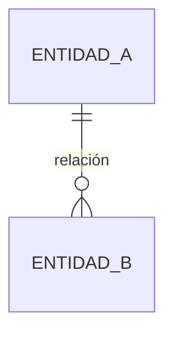

# product-discovery

Skill 1 del ciclo `it-project-orchestrator`.

Convierte una idea o pitch en un PRD consensuado y un backlog de historias con criterios
de aceptación. No requiere acceso al código fuente — trabaja con documentación o con un
briefing generado por el tech lead.

---

## REGLAS GENERALES

1. **Límite Estricto de Fin de Turno (Un Solo Paso por Mensaje):**
   Cada paso con pausa `🛑` marca el FIN OBLIGATORIO DE TU RESPUESTA.
   QUEDA TERMINANTEMENTE PROHIBIDO encadenar múltiples pasos en el mismo turno, simular o responder por cuenta propia preguntas del usuario, o avanzar al paso siguiente sin que el usuario haya respondido en la conversación. Al terminar las preguntas o el entregable de un paso, DETÉN TU RESPUESTA INMEDIATAMENTE y cede el turno al usuario.
2. **Nunca hacer commits.** El orquestador es el único responsable de git.
   Cuando un paso produce un archivo listo para commitear, avisar al orquestador
   con el mensaje: `[LISTO PARA COMMIT] <ruta del archivo> — confirmar antes de continuar.`
3. **Leer siempre desde disco** en los pasos que lo indican. No usar el contexto de la
   conversación como fuente de verdad para contenido ya persistido.
4. Marcar todo supuesto no confirmado como `[SUPUESTO]` en los archivos.
5. Marcar todo lo fuera del scope acordado como `[FUERA DE ALCANCE]`.
6. Usar el idioma configurado en onboarding en todos los archivos generados.
7. Si el usuario no tiene clara una decisión metodológica, **proponer con sustento**.
   Si la decisión elegida tiene riesgos conocidos, **advertirlo antes de continuar**.
8. **Concisión en Chat vs. Persistencia en Disco:**
   - **Si `tiene_repositorio = true`:** Todo documento formal se escribe en disco. En el chat SOLO se muestra un resumen ejecutivo conciso con enlaces a los archivos generados. **QUEDA TERMINANTEMENTE PROHIBIDO pegar o repetir el texto completo del documento `.md` en el mensaje de chat**.
   - **Si `tiene_repositorio = false`:** El contenido completo sí se muestra en la conversación, ya que no hay persistencia en disco y es el insumo necesario para que el usuario valide y se generen los PDFs descargables.

---

## PASO 0 — Onboarding

**Ejecutar solo al inicio si no se han determinado las variables de sesión.**

### 0a — Detectar idioma

Antes de preguntar nada, revisar si existen archivos `.md` en `docs/`.

- Si existen: detectar el idioma dominante leyendo uno o dos archivos.
  Confirmar al usuario: `"Detecto que el proyecto usa [idioma]. ¿Seguimos en ese idioma?"`
- Si no existen: preguntar al usuario:
  `"¿En qué idioma trabajamos? (español / inglés / otro)"`

El idioma queda en memoria de la sesión. No se escribe en ningún archivo de config.

### 0b — Preguntas iniciales de contexto

Preguntar al usuario de forma concisa:

```
1. Repositorio de destino:
   a) Sí (escribir y versionar archivos en repositorio del proyecto)
   b) No (trabajar solo en la conversación)

2. Base del proyecto:
   a) Greenfield (nuevo desde cero)
   b) Brownfield (código existente a explorar)

3. Idea / Requerimiento:
   Breve descripción de lo que querés construir o explorar.
```

Guardar en memoria de sesión:
- `tiene_repositorio: true (a) | false (b)`
- `tipo_proyecto: greenfield (a) | brownfield (b)`

### 0c — Configurar herramienta de issues (SOLO si `tiene_repositorio = true`)

**Si `tiene_repositorio = true`:**
Generar la carpeta `docs/config-project-orchestrator/` y dentro el archivo `tool-config.md` a partir del template `templates/tool-config.template.md` (con opciones comentadas de fácil selección y remoción).

**🛑 FIN DE TURNO OBLIGATORIO — ESPERA AL USUARIO:**
Indicar al usuario:

> "📄 Generé `docs/config-project-orchestrator/tool-config.md` con opciones predefinidas. Deja activa solo la opción deseada por campo cuando puedas. No hace falta completarlo ahora — podemos continuar con el discovery y volver a él antes de la fase de tickets."

DETÉN tu respuesta inmediatamente aquí. PROHIBIDO ejecutar el Paso 1 en este mismo turno. Espera a que el usuario confirme o responda en el chat.

**Si `tiene_repositorio = false`:**
NO generar ningún archivo en disco. Las preferencias de herramientas se consultarán directamente en la conversación cuando sea necesario (Paso 14). Continuar directamente al Paso 1.

---

## PASO 1 — Exploración / Briefing

Leer `docs/config-project-orchestrator/tool-config.md` para determinar la variante (campo `tipo_proyecto`). Si el archivo no existe o el campo está vacío, preguntar al usuario.

### Variante A — Brownfield con acceso al repo

Pedir al usuario que indique la ruta o rutas a explorar (soporta mono y multi-repo).

Explorar las rutas indicadas y producir:

```
1. Lista de capabilities existentes:
   - Autenticación y autorización
   - Modelos y entidades principales
   - Servicios e integraciones externas
   - Flujos de usuario ya implementados

2. Diagrama Mermaid del modelo de datos actual:
   - Solo entidades y relaciones
   - Sin tipos de columna, índices ni nombres de campo internos
```

Formato de salida:

```markdown
## Capabilities existentes
- Auth: <descripción>
- Módulo X: <descripción>
...

## Modelo de datos actual

```

**🛑 FIN DE TURNO OBLIGATORIO — ESPERA AL USUARIO:**
1. Muestra el mapa y pregunta: `"¿El mapa es completo? ¿Hay rutas adicionales que explorar?"`
2. DETÉN tu respuesta inmediatamente aquí. PROHIBIDO ejecutar el Paso 2 en este mismo turno. Espera confirmación o ajustes del usuario.

---

### Variante B — Brownfield sin acceso al repo

Verificar si `docs/tech-briefing.md` existe.

- Si existe: leerlo y confirmar al usuario: `"Encontré el tech-briefing. Lo usaré como base."`
- Si no existe: informar al usuario:
  ```
  No encontré docs/tech-briefing.md.
  El tech lead debe generarlo antes de continuar.
  Plantilla disponible en: docs/tech-briefing-template.md
  Avísame cuando esté listo.
  ```
  Esperar confirmación. Luego leer el archivo.

**🛑 FIN DE TURNO OBLIGATORIO — ESPERA AL USUARIO:**
DETÉN tu respuesta inmediatamente aquí. NO continúes al Paso 2 sin confirmación explícita del usuario en el chat.

---

### Variante C — Greenfield

Verificar si `docs/kickoff-brief.md` existe.

- Si existe: leerlo y confirmar: `"Encontré el kickoff-brief. Lo usaré como base."`
- Si no existe: informar al usuario:
  ```
  No encontré docs/kickoff-brief.md.
  Podés completarlo antes de continuar (plantilla en docs/kickoff-brief-template.md),
  o si preferís, puedo arrancar directamente con el discovery y el agente
  recopilará el contexto por preguntas.
  ¿Qué preferís?
  ```
  Esperar respuesta. Si elige arrancar directo, registrar que no hay briefing y continuar.

**🛑 FIN DE TURNO OBLIGATORIO — ESPERA AL USUARIO:**
DETÉN tu respuesta inmediatamente aquí. PROHIBIDO pasar al Paso 2 en este mismo turno. Espera la respuesta del usuario.

---

## PASO 2 — Discovery

**Subagente:** `it-project-orchestrator:discovery-agent` (Fase A)

Si el usuario ya proporcionó su idea, pitch o requerimiento (producto nuevo, nueva feature o mejora), tomarla directamente como input. Si aún no fue provista, solicitarla antes de invocar al subagente.

**Invocación del subagente:**
- **Contexto:** Idea o pitch del usuario + Mapa de capabilities del Paso 1 (si hubo exploración previa de código).
- **Tarea:** Ejecutar Fase A (reducción de incertidumbre): formular entre 5 y 10 preguntas clave sobre problema, usuarios y alcance, con nota al margen inferior de opciones (responder directo, "Fuera de scope", "Resolver como [SUPUESTO]", agregar detalles).

**🛑 FIN DE TURNO OBLIGATORIO — ESPERA AL USUARIO:**
1. Muestra la lista de preguntas formuladas por el subagente con su guía de opciones.
2. DETÉN tu respuesta inmediatamente aquí.
3. QUEDA TERMINANTEMENTE PROHIBIDO responder o asumir respuestas por tu cuenta.
4. NO invoques ningún otro subagente ni herramienta.
5. Espera a que el usuario responda en su siguiente mensaje para continuar al Paso 3.

---

## PASO 3 — Propuesta de alcance

**Subagente:** `it-project-orchestrator:discovery-agent` (Fase B)

**Invocación del subagente:**
- **Input:** Respuestas del usuario del Paso 2.
- **Tarea:** Ejecutar Fase B (propuesta de alcance en 5 bloques): estructurar Problema, Usuarios, Propuesta de valor, Alcance (IN) y NO-alcance (OUT) justificado, aplicando fuente cerrada, nivel no técnico y mapeo directo de supuestos/exclusiones.

**🛑 FIN DE TURNO OBLIGATORIO — ESPERA AL USUARIO:**
1. Muestra la propuesta de alcance en los 5 bloques.
2. Pregunta: `"¿Acotamos o ajustamos algo antes de consolidar?"`
3. DETÉN tu respuesta inmediatamente aquí.
4. QUEDA TERMINANTEMENTE PROHIBIDO crear archivos o avanzar al Paso 4 en este mismo turno.
5. Espera la confirmación o ajustes del usuario en su siguiente mensaje.

---

## PASO 4 — Consolidar alcance → disco

Primer archivo que se escribe a disco.

Proponer un sufijo basado en el requerimiento trabajado en el discovery (2-4 palabras en kebab-case que resuman el pedido):
`"Para los archivos usaría el sufijo '<sufijo-sugerido>' — por ejemplo: registro-ventas-mvp, auth-usuarios-v1. ¿Lo usamos o preferís otro?"`

Esperar confirmación o ajuste del usuario antes de continuar.

Reglas de consolidación:
- Fidelidad estricta: reflejar exactamente lo aprobado en el Paso 3 con los ajustes del usuario.
  PROHIBIDO agregar nuevos ítems al IN, relajar el foco o alterar las exclusiones de OUT.
- Preservar íntegramente las marcas [SUPUESTO] en cada ítem que corresponda.
- Exclusividad de alcance: NO incluir épicas, historias, métricas de éxito, arquitectura
  ni requisitos no funcionales (eso pertenece estrictamente al Paso 5 — PRD).

Generar `docs/prd/alcance-<sufijo>.md`:

```markdown
# Alcance — <Nombre del Proyecto> (<sufijo>)

> Fecha: YYYY-MM-DD
> Basado en: discovery del YYYY-MM-DD

## 1. Problema
<texto>

## 2. Usuarios
<texto>

## 3. Propuesta de valor
<texto>

## 4. Alcance (IN)
- <capacidad/ítem>
- <capacidad/ítem> [SUPUESTO si aplica]

## 5. NO-alcance (OUT)
| Excluido | Justificación |
|---|---|
| <ítem descartado en Paso 2 o 3> | <razón por la que no entra en esta entrega> |
```

**Si `tiene_repositorio = true`:**
- Escribir `docs/prd/alcance-<sufijo>.md` a disco.
- En el chat: mostrar únicamente un **resumen ejecutivo** (capacidades clave en IN, exclusiones justificadas en OUT, supuestos críticos) y el enlace al archivo generado `[docs/prd/alcance-<sufijo>.md](file:///...)`. **QUEDA TERMINANTEMENTE PROHIBIDO volcar el texto completo del markdown en el mensaje de chat**.
- Avisar: `[LISTO PARA COMMIT] docs/prd/alcance-<sufijo>.md`

**Si `tiene_repositorio = false`:**
- Mostrar el contenido completo en la conversación para revisión previa a la generación de PDFs. No escribir a disco. Las correcciones se hacen en el chat.

**🛑 FIN DE TURNO OBLIGATORIO — ESPERA AL USUARIO:**
1. Presenta el resumen ejecutivo con enlace al archivo (si hay repo) o el contenido completo en chat (si no hay repo).
2. Pregunta: `"¿El alcance consolidado refleja lo acordado o ajustamos algo antes de generar el PRD?"`
3. DETÉN tu respuesta inmediatamente aquí. PROHIBIDO generar el PRD o pasar al Paso 5 en este mismo turno.
4. Espera la confirmación del usuario para avanzar.

---

## PASO 5 — Generar PRD

**Fuente de entrada:**
- Si `tiene_repositorio = true`: leer desde disco `docs/prd/alcance-<sufijo>.md`. No usar el contexto volátil de la conversación.
- Si `tiene_repositorio = false`: tomar como base el alcance consensuado en el Paso 4 de la conversación.

Generar el PRD para la iniciativa (MVP, nueva feature o mejora) en `docs/prd/<proyecto>-<sufijo>.md`:

```markdown
# PRD — <Nombre del Proyecto> (<sufijo>)

> Versión: 0.1 (borrador)
> Fecha: YYYY-MM-DD
> Basado en: docs/prd/alcance-<sufijo>.md

## 1. Problema y contexto
<texto concreto — sin cifras de mercado inventadas>

## 2. Usuarios y jobs-to-be-done
| Usuario | Job-to-be-done | Pain actual |
|---|---|---|

## 3. Propuesta de valor
<texto>

## 4. Alcance / Fuera de alcance
### IN
- <item idéntico al consolidado en Paso 4>
### OUT
| Excluido | Justificación |
|---|---|
| <item idéntico al Paso 4> | <razón> |

## 5. Épicas del alcance
> Derivadas 1:1 de las capacidades del bloque IN. El usuario puede recortar este listado.
- E1: <nombre>
- E2: <nombre>
...

## 6. Requisitos no funcionales
- <item proporcional a la etapa> [SUPUESTO si no fue confirmado]

## 7. Restricciones técnicas
> Si el stack no está en la documentación del proyecto, preguntar al usuario.
> Sugerir con sustento si no está definido y advertir riesgos si la elección tiene trade-offs.
- Stack: <frontend> / <backend> / <DB> / <infra>
- <restricción adicional>

## 8. Métricas de éxito
> Concretas y medibles directamente sobre esta entrega. Si no se pueden medir hoy, marcar [SUPUESTO].
| Métrica | Valor objetivo | Cómo medirla |
|---|---|---|
```

**Reglas de redacción y contención:**
- **Mapeo 1:1 de Épicas:** Las épicas de la sección 5 deben derivarse estrictamente de las capacidades listadas en el Alcance (IN) de `alcance-<sufijo>.md`. PROHIBIDO crear épicas para features accesorias o requerimientos no contemplados.
- **RNF proporcionales:** Los requisitos no funcionales deben ajustarse al tamaño y contexto del proyecto (evitar SLAs o complejidades enterprise prematuras). Marcar con `[SUPUESTO]` los propuestos por el agente.
- **Sin diseño técnico:** Nada de diagramas C4, modelos entidad-relación, endpoints ni esquemas de BD: esto es definición funcional de producto.
- **Alerta de detalle técnico:** Si aparece un detalle que corresponde a implementación, agregar nota al margen:
  `> ⚠️ Nota: '<fragmento>' es detalle de implementación — se abordará en el Paso 9 (tickets).`
- **Concreto y testeable:** No inventar cifras de mercado; todo supuesto no confirmado va con `[SUPUESTO]`.

**Si `tiene_repositorio = true`:**
- Escribir `docs/prd/<proyecto>-<sufijo>.md` a disco.
- En el chat: mostrar únicamente un **resumen ejecutivo estructurado** (tabla/lista de épicas derivadas 1:1, supuestos críticos, RNF clave) y el enlace al archivo generado `[docs/prd/<proyecto>-<sufijo>.md](file:///...)`. **QUEDA TERMINANTEMENTE PROHIBIDO volcar el texto completo del PRD en el mensaje de chat**.
- Avisar: `[LISTO PARA COMMIT] docs/prd/<proyecto>-<sufijo>.md`

**Si `tiene_repositorio = false`:**
- Mostrar el PRD completo en la conversación para revisión previa a la generación de PDFs. No escribir a disco. Las correcciones se hacen en el chat.

**🛑 FIN DE TURNO OBLIGATORIO — ESPERA AL USUARIO:**
1. Muestra el resumen ejecutivo con enlace al archivo (si hay repo) o el PRD completo en chat (si no hay repo).
2. DETÉN tu respuesta inmediatamente aquí. PROHIBIDO invocar al revisor adversarial o pasar al Paso 6 en este mismo turno.
3. Espera la revisión y confirmación del usuario para avanzar.

---

## PASO 6 — Revisión adversarial del PRD

**Subagente:** `it-project-orchestrator:adversarial-reviewer`

**Invocación del subagente:**
- **Fuente del PRD:**
  - Si `tiene_repositorio = true`: leer `docs/prd/<proyecto>-<sufijo>.md` desde disco.
  - Si `tiene_repositorio = false`: usar el PRD consensuado en la conversación (Paso 5).
- **Tarea:** Atacar el PRD evaluando supuestos asesinos, ambigüedades funcionales, scope creep oculto y métricas de vanidad, emitiendo el informe de hallazgos clasificados por riesgo (🔴 Alto, 🟡 Medio, 🟢 Menor) y preguntas clave para consolidar la v0.2.

**🛑 FIN DE TURNO OBLIGATORIO — ESPERA AL USUARIO:**
1. Muestra el informe de hallazgos y preguntas clave del revisor adversarial.
2. DETÉN tu respuesta inmediatamente aquí. PROHIBIDO responder las preguntas por tu cuenta o generar historias.
3. Espera la respuesta del usuario para incorporar los cambios y consolidar la v0.2.

Tras confirmación explícita del usuario:
- Si `tiene_repositorio = true`: actualizar el archivo en disco.
  `[LISTO PARA COMMIT] docs/prd/<proyecto>-<sufijo>.md (v0.2)`
- Si `tiene_repositorio = false`: mostrar el PRD actualizado completo en la conversación para que el usuario confirme antes de avanzar al Paso 7.

---

## PASO 7 — Descomponer épicas en historias

**Subagente:** `it-project-orchestrator:backlog-enrich-agent` (Fase A)

**Invocación del subagente:**
- **Fuente del PRD:**
  - Si `tiene_repositorio = true`: leer desde disco `docs/prd/<proyecto>-<sufijo>.md`.
  - Si `tiene_repositorio = false`: usar el PRD confirmado en la conversación (Paso 5/6).
- **Tarea:** Descomponer las épicas en historias de usuario formato INVEST (`"Como <rol>, quiero <acción> para <beneficio>"`), auto-validando contra el alcance y marcando explícitamente `[FUERA DE ALCANCE]` las que no correspondan.

**🛑 FIN DE TURNO OBLIGATORIO — ESPERA AL USUARIO:**
1. Muestra el listado de historias INVEST y pregunta:
   `"¿Querés reorganizar alguna historia o ajustar la descomposición antes de continuar?"`
2. DETÉN tu respuesta inmediatamente aquí. PROHIBIDO generar criterios Given/When/Then o pasar al Paso 8 en este mismo turno.
3. Espera la confirmación del usuario.

---

## PASO 8 — Enriquecer historias con criterios

**Subagente:** `it-project-orchestrator:backlog-enrich-agent` (Fase B)

**Invocación del subagente:**
- **Input:** Historias aprobadas en el Paso 7.
- **Tarea:** Redactar criterios Given/When/Then como reglas de negocio observables (camino feliz y edge cases; marcar `[PROPUESTO]` los propios), sin endpoints ni status codes.
- **Persistencia o entrega:**
  - **Si `tiene_repositorio = true`:**
    - Escribir en disco cada historia en `docs/backlog/<E-nombre-epica>/us-<nombre-historia>.md`.
    - En el chat: mostrar únicamente una **tabla resumen de historias generadas** (ID, Épica, Título, Cantidad de criterios G/W/T, Supuestos) y enlaces a los archivos en disco. **QUEDA TERMINANTEMENTE PROHIBIDO volcar el contenido completo de los archivos `us-*.md` en el chat**.
    - Avisar: `[LISTO PARA REVISIÓN] Historias guardadas en docs/backlog/. Pedir al usuario que las revise en los archivos o indique cambios en el chat.`
  - **Si `tiene_repositorio = false`:**
    - Mostrar cada historia completa con sus criterios en la conversación para revisión previa a los PDFs. No escribir a disco. Las correcciones se hacen en el chat. Una vez que el usuario confirme todas las historias, continuar al HANDOFF.

**🛑 FIN DE TURNO OBLIGATORIO — ESPERA AL USUARIO:**
1. Presenta la tabla resumen de historias generadas con enlaces a disco (si hay repo) o el detalle completo en chat (si no hay repo).
2. DETÉN tu respuesta inmediatamente aquí.
3. Espera la revisión y confirmación explícita del usuario.

Tras confirmación explícita:
- Si `tiene_repositorio = true`: `[LISTO PARA COMMIT] docs/backlog/ — el orquestador debe hacer el commit.`
- Si `tiene_repositorio = false`: Continuar al HANDOFF AL SKILL 2 sin commit.

---

## HANDOFF AL SKILL 2

Al completar el Paso 8 y recibir confirmación del usuario:

**Si `tiene_repositorio = true`:**

```
✅ product-discovery completado.

Archivos generados:
- docs/prd/alcance-<sufijo>.md
- docs/prd/<proyecto>-<sufijo>.md
- docs/backlog/<E-epica>/us-*.md (<N> historias)

Próximo paso: stories-to-tickets (Pasos 9–14)
Lo corre el tech lead o dev senior con acceso al repo completo.
Input requerido: docs/backlog/<E-epica>/us-*.md
```

**Si `tiene_repositorio = false`:**

Antes de generar ningún PDF, mostrar en la conversación el texto exacto que se usará
para cada documento, en este orden:

```
📄 ALCANCE — alcance-<sufijo>.pdf
[contenido completo del alcance tal como fue consensuado]

---
📄 PRD — <proyecto>-<sufijo>.pdf
[contenido completo del PRD tal como fue consensuado]

---
📄 HISTORIA US-01 — us-<historia>.pdf
[contenido completo de la historia]

... (una sección por historia)
```

Preguntar: `"¿Este es el texto exacto que debe ir en los PDFs? Confirmá para generarlos."`

Esperar confirmación explícita antes de generar. Si el usuario pide cambios,
incorporarlos y volver a mostrar el bloque afectado antes de confirmar de nuevo.

Una vez confirmado, generar los PDFs descargables en el chat:
- `alcance-<sufijo>.pdf`
- `<proyecto>-<sufijo>.pdf`
- `us-<historia>.pdf` — uno por historia

Entregar los archivos con este mensaje:

> "📦 Estos PDFs deben ser entregados al equipo técnico para su registro y versionado en el repositorio del proyecto. Son el input que el equipo necesita para continuar con la generación de tickets e issues."

