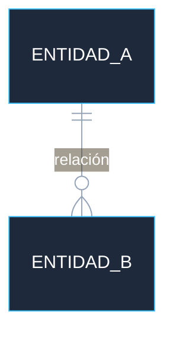

# Tech Briefing — <Nombre del Proyecto>

> Generado por: <Nombre del Tech Lead>
> Fecha: YYYY-MM-DD
> Versión: 1.0

---

## 1. Resumen ejecutivo
<!-- Qué hace el sistema hoy en 3–5 líneas -->

## 2. Capabilities existentes
<!-- Funcionalidades ya implementadas: auth, módulos, flujos principales -->

## 3. Modelo de datos simplificado
<!-- Entidades principales y relaciones. Mermaid obligatorio. Sin tipos de columna ni índices. -->

## 4. Stack tecnológico
| Capa | Tecnología |
|---|---|
| Frontend | |
| Backend | |
| Base de datos | |
| Infra / Deploy | |

## 5. Integraciones externas
<!-- APIs de terceros, webhooks, servicios conectados -->

## 6. Restricciones técnicas
<!-- Limitaciones de arquitectura que acotan lo que se puede construir -->

## 7. Deuda técnica relevante
<!-- Solo la que afecta el MVP o feature en cuestión -->

## 8. Seguridad / compliance
<!-- Si aplica al dominio: autenticación, roles, datos sensibles, regulaciones -->

## 9. Performance baseline
<!-- Métricas actuales relevantes si aplican: latencia, volumen de datos, usuarios concurrentes -->

## 10. Generado por / fecha
- **Autor:** 
- **Fecha:** 
- **Revisado por:** 
